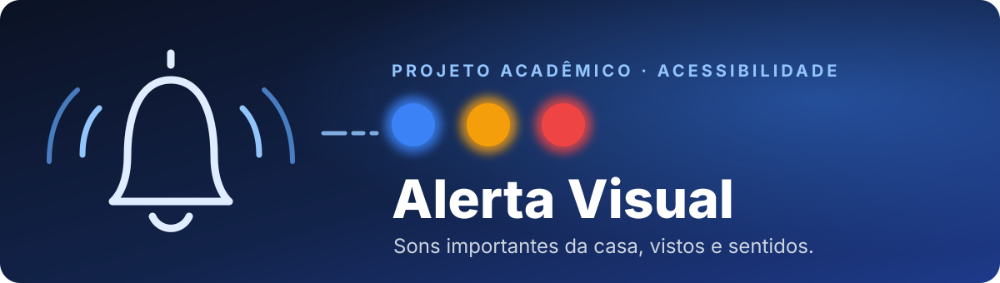
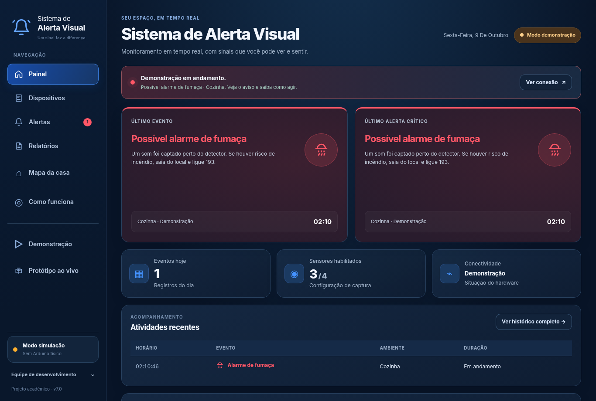
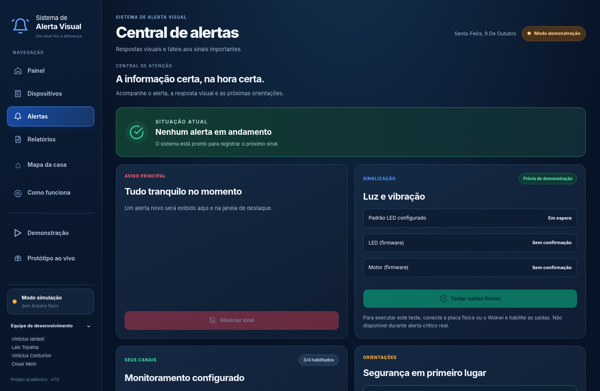
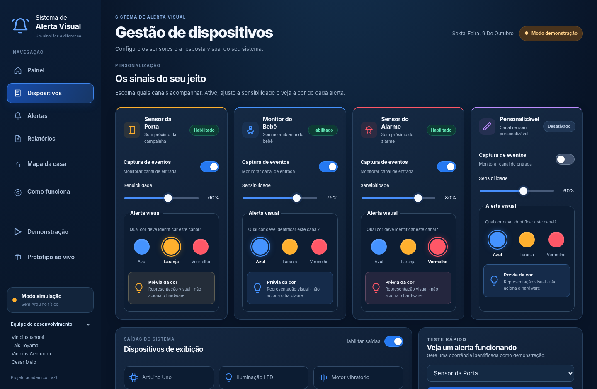
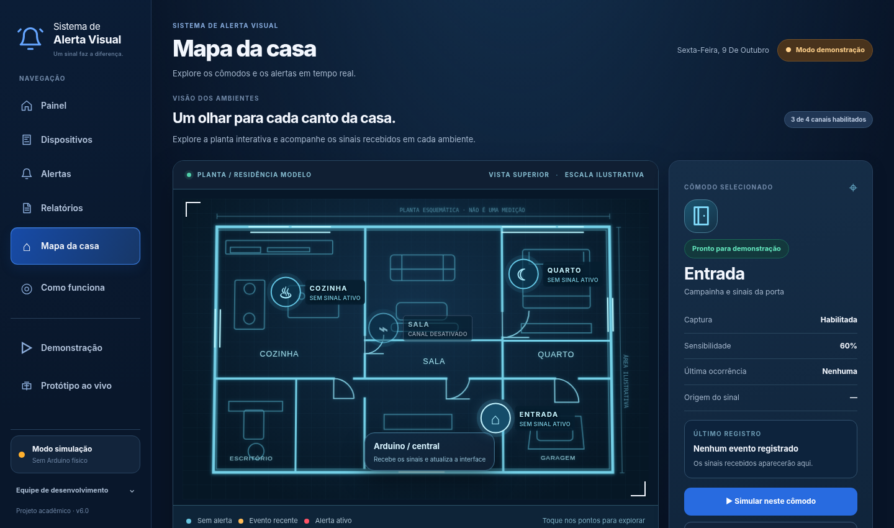
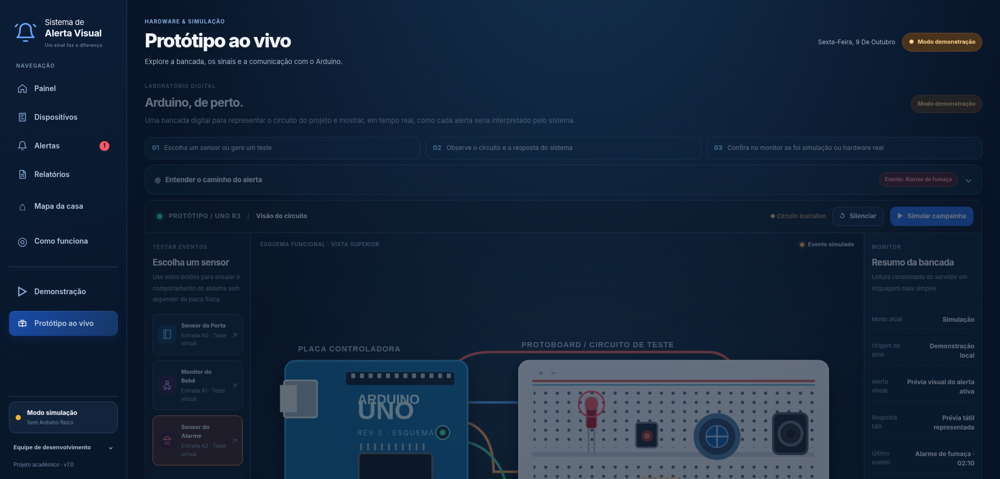
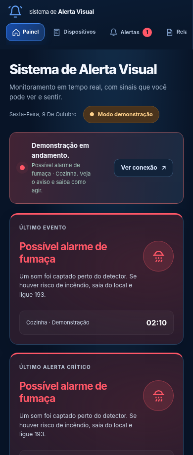
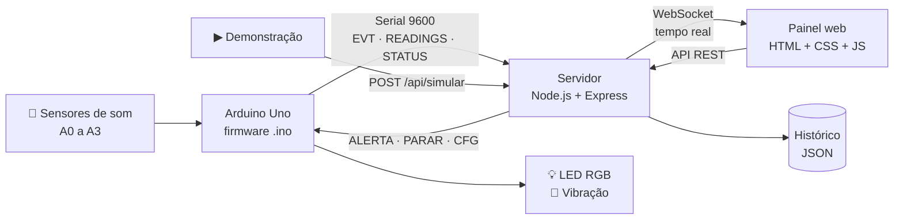

<div align="center">



<br />

**Um painel web + Arduino que transforma avisos sonoros (campainha, choro de bebê, alarme) em sinais visuais e táteis, para que pessoas surdas ou com deficiência auditiva percebam o que acontece em casa.**

<p>
  
  
  
  
</p>

[Problema](#-o-problema-e-a-solução) ·
[Telas](#-conheça-as-telas) ·
[Como funciona](#-como-funciona) ·
[Acessibilidade](#-acessibilidade-o-foco-do-projeto) ·
[Executar](#-como-executar) ·
[Arduino](#-arduino-e-wokwi) ·
[Testes](#-testes) ·
[Equipe](#-equipe)

</div>

---

## 💡 O problema e a solução

Campainha, interfone, alarme de fumaça e choro de bebê têm algo em comum: **avisam só por som**. Quem não ouve (ou está com fone, ou em um ambiente barulhento) pode perder um aviso importante.

O **Alerta Visual** capta esses sons e responde por outros sentidos:

|  | Sentido | Como o sistema avisa |
| :---: | :--- | :--- |
| 👁️ | **Visão** | Alerta em tela cheia, ícone, cor e texto; fita de LED colorida no Arduino. |
| ✋ | **Tato** | Motor de vibração no Arduino e vibração do celular, quando o aparelho permite. |
| 🗂️ | **Memória** | Histórico de cada ocorrência, com relatório e exportação em CSV. |

> [!IMPORTANT]
> **Protótipo experimental, não é um sistema de segurança certificado.** Os sensores medem a **amplitude do som**; eles não reconhecem sozinhos uma campainha, um choro ou fumaça. O canal "alarme de fumaça" escuta o **apito de um detector independente**, não detecta fumaça. Não use este protótipo como único aviso para situações de risco.

## 🖥️ Conheça as telas

<div align="center">
  
  <br /><sub><b>Painel</b> · visão geral, último evento, canais e estado do hardware</sub>
</div>

<br />

<table>
  <tr>
    <td width="50%" align="center">
      
      <br /><b>Alertas</b><br /><sub>aviso principal, saídas de luz e vibração, orientações</sub>
    </td>
    <td width="50%" align="center">
      
      <br /><b>Dispositivos</b><br /><sub>ativar canais, ajustar sensibilidade e cor do aviso</sub>
    </td>
  </tr>
  <tr>
    <td width="50%" align="center">
      
      <br /><b>Mapa da casa</b><br /><sub>cômodos, canais e simulação por ambiente</sub>
    </td>
    <td width="50%" align="center">
      
      <br /><b>Protótipo ao vivo</b><br /><sub>bancada do Arduino e monitor das mensagens</sub>
    </td>
  </tr>
</table>

<details>
<summary><b>📱 Ver no celular</b></summary>

<br />
<div align="center">
  
</div>

</details>

| Tela | Para que serve |
| :--- | :--- |
| **Painel** | Resumo do sistema: último evento, canais ativos, histórico recente e estado do Arduino. |
| **Dispositivos** | Liga/desliga cada canal, ajusta a sensibilidade e escolhe a cor do aviso. |
| **Alertas** | Mostra o alerta em andamento, as saídas de luz/vibração e permite silenciar. |
| **Relatórios** | Gráfico por horário, tipos de evento, tabela filtrável (período, tipo, origem), CSV. |
| **Mapa da casa** | Planta interativa: escolha um cômodo e simule um evento nele. |
| **Como funciona** | Explicação visual do caminho do sinal, do sensor à tela. |
| **Demonstração** | Roteiro guiado de apresentação, com eventos marcados como simulação. |
| **Protótipo ao vivo** | Bancada ilustrada do Arduino com leituras e mensagens em tempo real. |

## 🧩 Como funciona



**Do som ao aviso, em quatro passos:**

1. **Entrada:** um sensor de som detecta um pico de amplitude (ou o usuário aciona uma simulação).
2. **Processamento:** o servidor valida o evento, ignora repetições em menos de 3 s e grava no histórico.
3. **Aviso:** o painel recebe o evento por WebSocket e abre o alerta em tela cheia, sem recarregar a página. Se houver Arduino conectado, o servidor também manda acender o LED e acionar a vibração.
4. **Registro:** o evento fica no histórico até alguém silenciar, com horário, origem e duração.

| Canal | Ambiente | Entrada | Aviso no LED | Vibração |
| :--- | :--- | :---: | :--- | :--- |
| Campainha | Entrada | `A0` | pisca lento | pulso curto |
| Bebê | Quarto | `A1` | pulsante suave | pulso médio |
| Alarme de fumaça | Cozinha | `A2` | pisca intermitente (2 por segundo) | pulso rápido |
| Personalizável | Sala | `A3` | pisca lento | pulso curto |

Alertas comuns terminam sozinhos em 15 s. O de fumaça é **crítico**: continua até alguém silenciar (ou 10 minutos).

### 🛠️ Tecnologias

| Camada | Tecnologia | Papel |
| :--- | :--- | :--- |
| Interface | HTML5, CSS3, JavaScript (sem frameworks) | Telas, mapa SVG, relatórios, acessibilidade |
| Servidor | Node.js, Express | API REST, regras de negócio, histórico |
| Tempo real | WebSocket (`ws`) | Eventos e estados sem recarregar a página |
| Hardware | Arduino Uno (C++), `serialport` | Leitura dos sensores e controle de LED/vibração |
| Simulação | Wokwi + ponte Python (opcional) | Circuito virtual ligado ao painel |

## ♿ Acessibilidade: o foco do projeto

O sistema foi pensado para quem **não pode depender do áudio**:

- **Nunca só cor:** todo evento aparece com **cor + ícone + texto**.
- **Alerta em tela cheia** com botão grande de silenciar; o resto da página fica inativo enquanto ele está aberto, para o foco do teclado e do leitor de tela não escaparem.
- **Vibração do celular** quando o navegador permite.
- **Aba em segundo plano:** o título da aba muda para "⚠ Alerta ativo".
- **Teclado e leitor de tela:** link "Pular para o conteúdo", interruptores com `role="switch"`, avisos em regiões `aria-live` e selo de alerta com texto.
- **Menos movimento:** respeita a preferência do sistema por animações reduzidas.
- **Transparência:** testes simulados são sempre marcados como "simulação" e nunca aparecem como dado real do Arduino.

## 🚀 Como executar

**Precisa de:** [Node.js 18 ou superior](https://nodejs.org) (recomendado o 20 LTS) e um navegador atual. Arduino **não é necessário** para apresentar.

```bash
cd backend
npm install
npm start
```

Abra **http://localhost:3000**. Pronto.

> [!TIP]
> **Sem Arduino?** O sistema inicia em **modo demonstração**. Use a tela **Demonstração** (roteiro guiado) ou o **Mapa da casa** para gerar eventos de teste.

Para encerrar, use `Ctrl+C`: o servidor desliga o LED, grava o alerta em andamento como "Interrompido" e fecha as conexões.

<details>
<summary><b>⚙️ Variáveis de ambiente (opcional)</b></summary>

<br />

| Variável | Padrão | Função |
| :--- | :---: | :--- |
| `PORT` | `3000` | Porta do painel. |
| `HOST` | `127.0.0.1` | Endereço de escuta. Só mude em rede confiável: não há login. |
| `SERIAL_PORT` | vazio | Porta do Arduino (`COM3`, `/dev/ttyACM0`). Vazio = modo demonstração. |
| `SIM_TCP_PORT` | vazio | Ativa a ponte local do Wokwi. |
| `DATA_DIR` | `backend/data` | Pasta do histórico e das configurações. |

</details>

## 🔌 Arduino e Wokwi

### Montagem

| Peça | Pino | Observação |
| :--- | :---: | :--- |
| Sensor de som da campainha | `A0` | Módulo analógico (ex.: KY-038 ou MAX4466), saída `AO` |
| Sensor de som do bebê | `A1` | idem |
| Sensor de som do detector de fumaça | `A2` | idem |
| Sensor de som personalizável | `A3` | idem |
| LED RGB (vermelho, verde, azul) | `D9`, `D10`, `D11` | Com resistores; fita de 12 V exige driver e fonte própria |
| Motor de vibração | `D5` | Via transistor e diodo; **nunca direto no pino** |
| Botão de silenciar *(opcional)* | `D7` e `GND` | Pull-up interno; silencia na placa e avisa o painel |

Sensores em 5 V, com `GND` comum.

### Usando a placa real

1. Abra `arduino/alerta_visual/alerta_visual.ino` na Arduino IDE e grave na placa (Arduino Uno).
2. Descubra a porta serial (aparece na IDE) e **feche o Monitor Serial**, para liberar a porta.
3. Inicie o servidor informando a porta:

```powershell
# Windows (PowerShell)
cd backend
$env:SERIAL_PORT="COM3"   # troque pela sua porta
npm start
```

```bash
# Linux / macOS
cd backend
SERIAL_PORT=/dev/ttyACM0 npm start
```

O indicador na lateral do painel passa a mostrar que o Arduino está conectado. Velocidade serial: 9600 baud.

<details>
<summary><b>🧪 Circuito virtual no Wokwi (opcional)</b></summary>

<br />

Permite demonstrar o firmware sem a placa física. Precisa de VS Code com a extensão Wokwi, Arduino CLI e Python.

```bash
# 1) na raiz do projeto: compilar o firmware de demonstração
arduino-cli compile --fqbn arduino:avr:uno --output-dir wokwi/build wokwi/alerta_demo

# 2) iniciar o circuito pela extensão Wokwi no VS Code (usa wokwi/wokwi.toml)

# 3) em outro terminal: servidor com a ponte habilitada
cd backend
SIM_TCP_PORT=4001 npm start          # PowerShell: $env:SIM_TCP_PORT="4001"; npm start

# 4) em outro terminal, na raiz: ponte Wokwi para o servidor
python -m pip install pyserial
python wokwi/bridge.py
```

A bancada desenhada no navegador é **ilustrativa**: ela não emula o firmware. Para isso, use o Wokwi.

</details>

<details>
<summary><b>📡 API e protocolo serial (para quem quiser entender por dentro)</b></summary>

<br />

**API REST** (`http://localhost:3000`)

| Método | Rota | Função |
| :---: | :--- | :--- |
| `GET` | `/api/estado` | Canais, saídas, hardware e alerta em andamento |
| `PUT` | `/api/dispositivos/:id` | Liga/desliga canal, sensibilidade, cor |
| `PUT` | `/api/exibicao` | Habilita ou não as saídas físicas (LED e vibração) |
| `GET` | `/api/eventos` | Eventos recentes |
| `GET` | `/api/estatisticas` | Contagens do painel |
| `GET` | `/api/relatorio?periodo=7d&fonte=todas` | Histórico filtrado (`periodo`: `hoje`, `7d`, `30d`, `todos`; `fonte`: `todas`, `reais`, `simulacao`) |
| `GET` | `/api/diagnostico` | Leituras e status enviados pelo Arduino |
| `POST` | `/api/simular` | Gera um evento de demonstração (`{"dispositivo":"porta"}`) |
| `DELETE` | `/api/eventos/simulacoes` | Apaga só os testes simulados |
| `POST` | `/api/alerta/silenciar` | Encerra o alerta em andamento |
| `POST` | `/api/hardware/testar` | Pede um sinal de teste ao Arduino |
| `WS` | `/ws` | Eventos em tempo real |

**Serial (9600 baud, uma linha por mensagem)**

| Sentido | Mensagem | Significado |
| :--- | :--- | :--- |
| Arduino → servidor | `HELLO,alerta_visual` | Placa iniciou |
| Arduino → servidor | `EVT,<canal>,<pico>` | Som acima do limiar no canal 0 a 3 |
| Arduino → servidor | `READINGS,<a0>,<a1>,<a2>,<a3>` | Amplitude atual de cada sensor |
| Arduino → servidor | `STATUS,<alerta>,<led>,<motor>` | Estado das saídas (0 ou 1) |
| Arduino → servidor | `SILENCIAR` | Botão físico pressionado |
| Servidor → Arduino | `CFG,<canal>,<limiar>` · `ATIVO,<canal>,<0\|1>` | Sensibilidade e liga/desliga |
| Servidor → Arduino | `ALERTA,<r>,<g>,<b>,<padrão>,<segundos>` | Dispara LED e vibração |
| Servidor → Arduino | `PARAR` · `TESTE` | Para o alerta / sinal de teste (3 s) |

</details>

## 🧪 Testes

```bash
cd backend
npm install        # já instala as ferramentas de teste
npm test           # regras do servidor (isolado, sem placa)
npm run test:ui    # sobe o servidor e percorre o painel sem navegador (jsdom)
```

| O que é verificado | Onde |
| :--- | :--- |
| Canais, persistência, simulação, relatórios, silenciamento, diagnóstico serial, proteção contra requisições de outros sites, erros em JSON, histórico corrompido | `npm test` |
| Painel completo: roteiro guiado, alerta em tela cheia, fundo inativo durante o alerta, relatórios e filtros, ausência de erros de JavaScript | `npm run test:ui` |
| Navegação e layout em vários tamanhos de tela (Playwright + Chromium) | `python tests/ui-playwright.py` e `python tests/ui-polimento.py` |

> Os testes de navegador usam uma API simulada. O **Arduino físico** e o **Wokwi** dependem de equipamento e devem ser conferidos no ambiente da apresentação.

<details>
<summary><b>🔧 O que foi refinado na versão 7.1</b></summary>

<br />

- **Correções:** texto explicativo em branco na demonstração guiada; reconexões serial duplicadas; eventos repetidos causados por ruído do próprio atuador; duração de alertas interrompidos.
- **Segurança:** recusa de requisições e WebSocket vindos de outros sites, cabeçalhos de segurança, erros sem detalhes internos, limite de simulações.
- **Robustez:** encerramento limpo com `Ctrl+C`, cópia de segurança de histórico corrompido, reconexão progressiva do WebSocket, prazo nas requisições.
- **Funcionalidades:** botão físico de silenciar, filtro de origem dos dados no relatório, CSV legível.
- **Acessibilidade:** fundo inativo durante o alerta, anúncio refeito a cada alerta, título da aba sinalizando alerta.

</details>

## 📂 Estrutura do projeto

```text
a3_acessibilidade/
├── frontend/                 # Painel web
│   ├── index.html            #   telas
│   ├── css/                  #   estilos e responsividade
│   └── js/                   #   api.js (comunicação) e app.js (telas)
├── backend/                  # Servidor Node.js
│   ├── server.js             #   API REST, WebSocket e serial
│   └── data/                 #   histórico e configurações (criado ao rodar)
├── arduino/alerta_visual/    # Firmware do Arduino Uno
├── wokwi/                    # Circuito virtual e ponte com o servidor
├── tests/                    # Testes automatizados e capturas de tela
└── docs/banner.svg           # Imagem do topo deste README
```

## 🎤 Roteiro sugerido para a apresentação (cerca de 8 minutos)

| Tempo | O que mostrar | O que falar |
| :---: | :--- | :--- |
| 1 min | Banner e problema | Avisos sonoros não alcançam quem não ouve. |
| 1 min | **Painel** | Tudo em um só lugar: canais, último evento e estado do hardware. |
| 2 min | **Demonstração** | Siga o roteiro guiado: um evento aparece em tela cheia, com cor, ícone e texto. Deixe claro que é simulado. |
| 1 min | **Mapa da casa** | Escolha um cômodo e simule um evento nele. |
| 2 min | **Arduino / Protótipo ao vivo** | Sensor → firmware → servidor → tela. Se houver a placa, acione um som real e mostre o LED. |
| 1 min | **Relatórios** | Histórico, filtro por origem (real × simulação) e exportação em CSV. Fale dos limites do protótipo. |

<details>
<summary><b>❓ Perguntas que podem surgir</b></summary>

<br />

**O sensor reconhece que o som é uma campainha?**
Não. Cada sensor mede a amplitude do som e o sistema atribui o significado pela **posição**: o sensor da porta representa a campainha, o do quarto, o bebê. É uma limitação assumida do protótipo.

**Detecta fumaça?**
Não diretamente. O canal da cozinha escuta o **apito de um detector de fumaça comum**; o detector é quem identifica a fumaça.

**Funciona sem o Arduino?**
Sim. Sem placa, o painel roda em modo demonstração e todo evento simulado fica marcado como tal.

**O que acontece se a internet cair?**
O sistema roda localmente (servidor e painel na mesma máquina), então não depende de internet.

**Qualquer pessoa na rede pode mexer?**
Por padrão o servidor só aceita acessos da própria máquina. Não há login; por isso a documentação recomenda não expô-lo à rede.

**Como evoluir o projeto?**
Aviso por notificação no celular ou SMS, reconhecimento do tipo de som (classificação de áudio), sensores sem fio e login para acesso remoto.

</details>

## 👥 Equipe

<div align="center">

**Vinicius Iandoli · Lais Toyama · Vinicius Centurion · Cesar Melo**

<sub>Projeto acadêmico · a3_acessibilidade · Alerta Visual</sub>

<br />

*A tecnologia deve ampliar o acesso à informação.*

</div>
